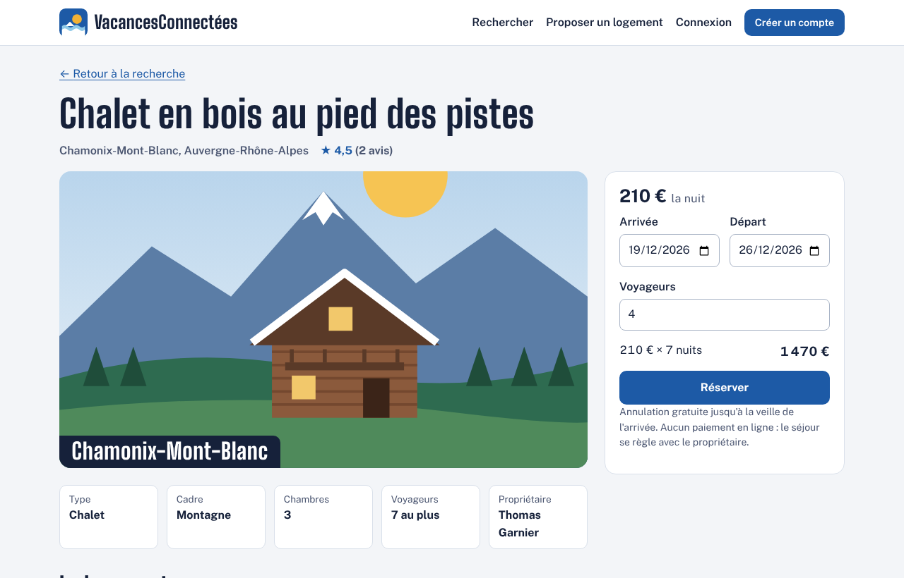
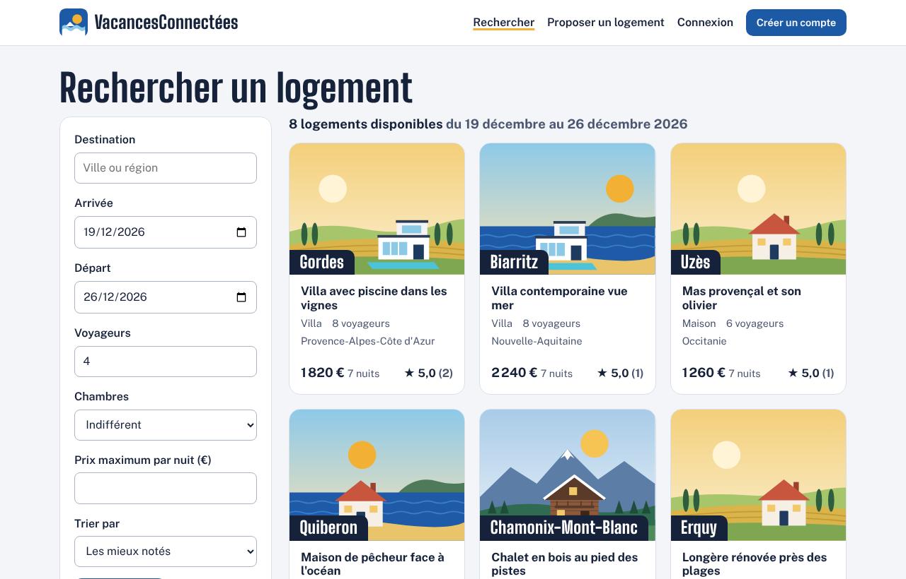
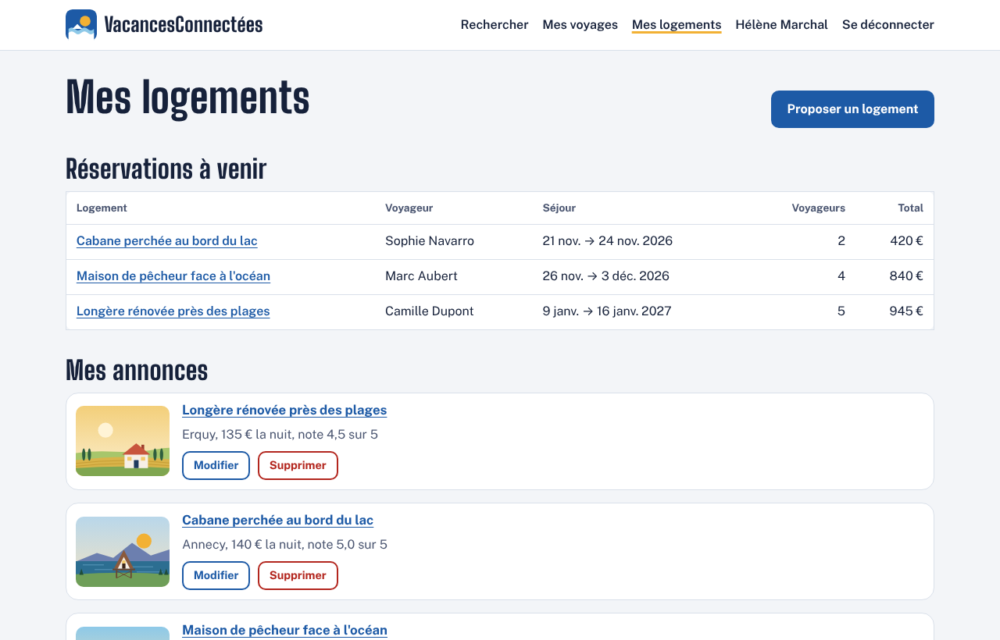

# VacancesConnectées

Site de location de logements de vacances entre particuliers : on cherche un logement libre à ses dates, on le réserve, puis on laisse un avis après le séjour. Les propriétaires publient leurs logements et suivent leurs réservations. Le site est écrit en PHP sans framework, avec une base MySQL, MariaDB ou SQLite.

C'était mon projet de 2e année de DEUST IOSI (INSA Hauts-de-France), rendu en mars 2024. Je l'ai ensuite réécrit en gardant le même sujet, pour corriger les failles de la première version : injections SQL, XSS et prise de contrôle de compte.

La [démo en ligne](https://vacances-connectees.onrender.com) donne à chaque visiteur sa propre copie du site, effacée au bout de deux heures. Les comptes de démonstration s'ouvrent en un clic depuis la page de connexion. Elle est hébergée gratuitement sur Render : le premier chargement peut prendre une minute.

<table>
  <tr>
    <td></td>
    <td></td>
  </tr>
  <tr>
    <td></td>
    <td></td>
  </tr>
</table>

## Fonctionnalités

- Recherche par destination, dates, nombre de voyageurs et prix maximum. Avec des dates, seuls les logements libres s'affichent, avec le prix du séjour.
- Fiche logement avec le calendrier des disponibilités et les avis des voyageurs.
- Réservation confirmée tout de suite si les dates sont libres, annulation possible jusqu'à la veille de l'arrivée, un avis par séjour après le départ.
- Espace propriétaire : publier, modifier ou supprimer un logement, ajouter une photo, voir les réservations à venir. Un email prévient le propriétaire à chaque réservation ou annulation.
- Comptes, avec un mot de passe oublié qui passe par un lien envoyé par email.
- Interface utilisable sur téléphone, sans JavaScript indispensable.

Il n'y a pas de paiement en ligne : le séjour se règle directement avec le propriétaire.

**Stack** : PHP 8.2+ sans framework (routeur, contrôleurs et accès à la base avec PDO), MySQL, MariaDB ou SQLite, GD pour les photos, CSS écrit à la main, PHPUnit, Docker pour la démo.

## Ce que j'ai corrigé

Le code de la première version (HTML, CSS, JavaScript et PHP avec mysqli) est conservé dans le premier commit du dépôt. Les problèmes les plus graves :

- **Prise de contrôle de compte** : la page « mot de passe oublié » changeait le mot de passe de n'importe quel compte à partir de sa seule adresse email. Le changement passe maintenant par un lien à usage unique envoyé à l'adresse du compte.
- **Injections SQL** : la recherche et la page de mot de passe oublié collaient les valeurs du formulaire dans le texte des requêtes.
- **XSS** : le titre et la description des annonces étaient affichés sans échappement, comme les dates de la recherche.
- **Réservations** : rien ne vérifiait que le logement était libre, ni que le départ suivait l'arrivée.
- **Configuration** : les accès à la base, avec le compte `root` sans mot de passe, étaient recopiés dans neuf fichiers, et aucun formulaire n'était protégé contre le CSRF.

J'en ai profité pour ajouter le calendrier, l'annulation, les avis, l'espace propriétaire, les emails, les tests et la démo en ligne.

## Sécurité

- Requêtes préparées partout, échappement de tout ce qui vient des utilisateurs, jeton CSRF sur chaque formulaire.
- Une réservation n'est visible que par le voyageur et le propriétaire, un logement ne se modifie que par son propriétaire. Pour les autres, la page répond « introuvable ».
- Le prix est calculé par le serveur, et les dates sont revérifiées au moment d'enregistrer, dans une transaction qui verrouille le logement : deux réservations envoyées en même temps ne peuvent pas prendre les mêmes nuits.
- Mots de passe hachés avec bcrypt, connexion bloquée 15 minutes après 5 échecs, même message et même temps de réponse pour un email inconnu et un mauvais mot de passe.
- Lien de réinitialisation valable 30 minutes, dont la base ne garde que l'empreinte SHA-256. Son adresse vient de la configuration, jamais de l'en-tête `Host` de la requête.
- Photos vérifiées sur leur contenu, puis réencodées en WebP sous un nom aléatoire. En-têtes de sécurité : CSP stricte, HSTS, `nosniff`, cookies `HttpOnly` et `SameSite`.

## Installation

Prérequis : PHP 8.2 ou plus récent avec les extensions `intl`, `mbstring`, `gd` et `pdo_sqlite` (ou `pdo_mysql`), et [Composer](https://getcomposer.org/).

```bash
git clone https://github.com/MiscuitAtlas/vacances-connectees.git
cd vacances-connectees
composer install
cp config/config.local.example.php config/config.local.php
```

Le plus simple est de décommenter la ligne SQLite dans `config/config.local.php`. Pour MySQL ou MariaDB, il faut créer la base et renseigner ses accès dans ce même fichier. Ensuite :

```bash
php bin/install.php --demo    # crée les tables et ajoute les données de démonstration
composer serve                # http://localhost:8000
```

Deux comptes de démonstration, avec le mot de passe `vacances-demo` : `demo@exemple.fr` (voyageuse) et `hote@exemple.fr` (propriétaire de trois logements). En local, les emails ne sont pas envoyés : ils sont écrits dans `var/mail`.

La démo tourne aussi avec Docker, sans PHP ni base de données à installer :

```bash
docker build -t vacances-connectees .
docker run --rm -p 8080:10000 vacances-connectees    # http://localhost:8080
```

## Tests

```bash
composer test        # PHPUnit, sur une base SQLite en mémoire
composer cs-check    # règles de codage PSR-12
```

Les 63 tests couvrent les dates de séjour, la recherche, les réservations qui se chevauchent, les avis, la connexion et son blocage, le mot de passe oublié, les droits de chaque utilisateur sur les logements et les réservations, et la démo en ligne.

## Structure

```
bin/            installation et base de la démo
config/         configuration par défaut et exemple de configuration locale
database/       schémas MySQL et SQLite
public/         racine du site : index.php, CSS, polices, photos envoyées
src/            routeur, sécurité, contrôleurs, requêtes SQL, services (réservation, emails, photos)
templates/      pages
tests/          tests unitaires, d'intégration et de parcours HTTP
```

## Limites

- Le cahier des charges prévoyait aussi un paiement en ligne, une messagerie et une FAQ : ils ne font pas partie de cette version.
- Sur la démo en ligne, l'envoi de photos est désactivé pour qu'elle ne serve pas à héberger des images.

## Ce que j'ai appris

- **La faille la plus grave n'était pas une injection** : même avec des requêtes préparées, la page de mot de passe oublié de la première version aurait permis de prendre n'importe quel compte. C'était une erreur de logique, pas de code.
- **Vérifier puis enregistrer ne suffit pas** : deux réservations envoyées au même moment peuvent passer la vérification toutes les deux. Il faut revérifier dans une transaction qui verrouille le logement.
- **Ne pas construire de lien avec l'en-tête `Host`** : un attaquant pourrait le modifier pour que l'email de réinitialisation pointe vers son propre site. L'adresse du site vient donc de la configuration.

## Crédits

Polices [Big Shoulders](https://github.com/xotypeco/big_shoulders) (The Big Shoulders Project Authors) et [Public Sans](https://github.com/uswds/public-sans) (The Public Sans Project Authors), sous licence SIL Open Font License : voir `public/assets/fonts/`.

## Auteur

Projet réalisé en 2e année de DEUST Informatique d'organisation et systèmes d'information (INSA Hauts-de-France), puis réécrit.

**Maxence Français** : [portfolio](https://miscuitatlas.github.io) · [LinkedIn](https://www.linkedin.com/in/maxence-fran%C3%A7ais-a039a2307/)
